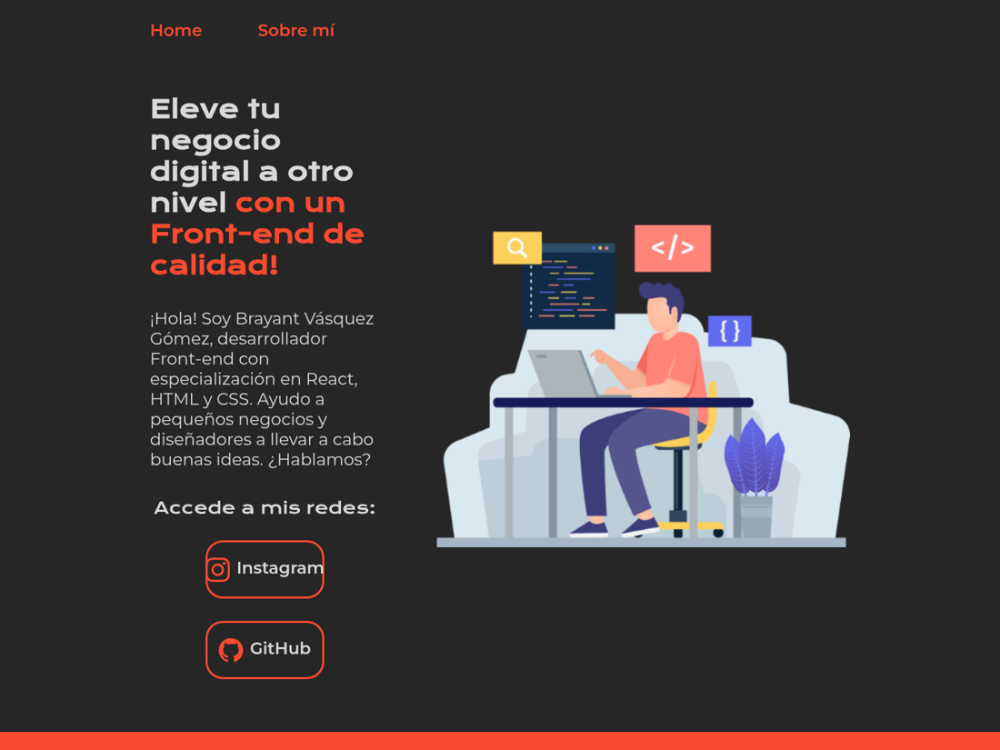

# Portafolio — Brayant Vásquez Gómez


Sitio personal estático con una página de presentación y otra "Sobre mí". Está hecho solo con HTML y CSS, sin dependencias ni proceso de compilación.



<!-- TODO: enlace al sitio publicado (GitHub Pages: Settings → Pages) -->

## Contenido

- **Home:** presentación y enlaces a mis redes (Instagram y GitHub).
- **Sobre mí:** página de perfil (en construcción).

## Stack

HTML5 · CSS3 (variables CSS, Flexbox y media queries) · Google Fonts (Krona One y Montserrat)

## Estructura

```
index.html   -> página de inicio
about.html   -> sobre mí
style.css    -> estilos compartidos
assets/      -> íconos de redes
```

## Cómo verlo en local

No requiere instalación. Abre `index.html` en el navegador o sirve la carpeta:

```bash
python3 -m http.server 8000
```

Luego visita http://localhost:8000.

## Autor

**Brayant Vásquez Gómez** · [GitHub](https://github.com/iBrayant) · [LinkedIn](https://linkedin.com/in/brayant-vásquez-gómez)

Licencia [MIT](LICENSE) para el código. Las ilustraciones e imágenes de la carpeta raíz no son de mi autoría y conservan la licencia de sus respectivos autores.
